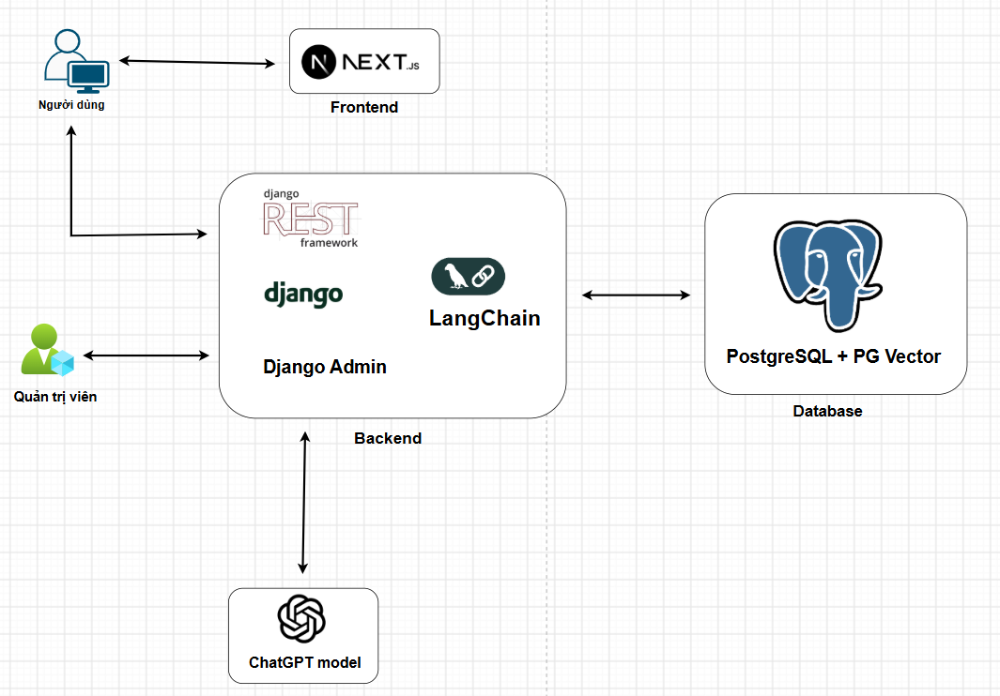

# 🎯 AI Career Coach — Trợ lý định hướng nghề nghiệp và luyện phỏng vấn thông minh


[](./LICENSE)
[](https://www.djangoproject.com/)
[](https://docs.langchain.com/)
[](https://platform.openai.com/docs/)
[](https://nextjs.org/docs)
[](https://www.postgresql.org/docs/)


## **AI Career Coach** là hệ thống ứng dụng **Trí tuệ nhân tạo (AI)** giúp phân tích khoảng cách năng lực của sinh viên, đề xuất lộ trình học tập cá nhân hóa và cung cấp môi trường luyện phỏng vấn ảo sát với thực tế tuyển dụng.

---

## 🎯 Mục tiêu của dự án

- 📄 **Phân tích & Đánh giá năng lực (Skill Gap Analysis):**  
  AI đọc **CV của sinh viên** hoặc **mô tả công việc (JD)**, trích xuất các skill, đánh giá level của mỗi skill dựa vào dự án thực tế, kinh nghiệm,.... Từ đó AI so sánh level của từng skill, đưa ra lộ trình học tập phù hợp .

- 🗺️ **Lộ trình học tập cá nhân hóa:**  
  Đề xuất lộ trình nâng cao kỹ năng, gợi ý tài liệu ôn tập và bài tập thực hành từ database phù hợp với khoảng cách năng lực của sinh viên.

- 🎙️ **Trợ lý phỏng vấn thông minh (AI Interview Simulator):**  
  Mô phỏng các buổi phỏng vấn giả định theo từng vị trí công việc, đưa ra bộ câu hỏi sát thực tế và phân tích/chấm điểm câu trả lời thời gian thực.

---

## 🛠️ Công nghệ sử dụng

| Thành phần | Công nghệ | Chức năng | Ưu điểm |
| :--- | :--- | :--- | :--- |
| **Frontend** | ⚛️ Next.js + TypeScript | Xây dựng giao diện người dùng tương tác, hiển thị lộ trình học và phòng phỏng vấn ảo. | Hiệu năng cao ⚡, trải nghiệm mượt mà, hỗ trợ SSR/SSG. |
| **Backend** | 🐍 Django + Django REST Framework | Xử lý logic nghiệp vụ, quản lý tài khoản, dữ liệu ngành nghề và hệ thống API. | Mạnh mẽ 💪, bảo mật, tích hợp **Django Admin** quản trị dữ liệu dễ dàng 🛠️. |
| **AI / LLM** | 🧠 LangChain + OpenAI | Trích xuất tri thức, phân tích CV/JD, chấm điểm phỏng vấn. | Xử lý ngữ cảnh thông minh 🤖. |
| **Database** | 🐘 PostgreSQL + pgvector | Lưu trữ dữ liệu hệ thống (User, CV, Kết quả) đồng thời lưu vector embedding để search similarity. | Gọn nhẹ, lưu trữ cả relational & vector trong cùng 1 cơ sở dữ liệu 🗄️. |

---

## 💡 Tính năng nổi bật

✅ **Upload & Phân tích CV tự động (PDF Parsing)**  
✅ **So sánh Skill Gap giữa CV và JD tuyển dụng**  
✅ **Tự động gợi ý lộ trình học & bài tập từ Database**  
✅ **Mô phỏng phỏng vấn AI và chấm điểm dựa trên đáp án chuẩn**  
✅ **Trang quản trị (Django Admin) quản lý Skill chuẩn, Job chuẩn & Ngân hàng câu hỏi**

---

## 🏗️ Kiến trúc hệ thống
<div align="center">
  
</div>

---

## 🧩 Yêu cầu hệ thống (Prerequisites)

- 🧰 **Git** – Quản lý mã nguồn.
- 📦 **Node.js (≥ 24)** & **npm (≥ 11)** – Chạy ứng dụng Next.js.
- 🐍 **Python (≥ 3.13)** & **pip** – Chạy backend Django và hệ sinh thái LangChain.
- 🔑 **OpenAI API Key** – Dùng cho mô hình GPT và Embeddings.

---

## 🚀 Hướng dẫn cài đặt & chạy nhanh

1. Clone repository

```bash
git clone https://github.com/leducmanh0838/ai-career-coach.git
cd ai-career-coach
```
2. Cấu hình biến môi trường .env

Trước khi chạy, cấu hình môi trường:
```bash
SECRET_KEY=your_django_secret_key

DB_NAME=ai_career_coach
DB_USER=postgres
DB_PASSWORD=your_postgres_password
DB_HOST=localhost
DB_PORT=5432

OPENAI_API_KEY=your_openai_api_key

GOOGLE_CLIENT_ID=your_google_client_id
GOOGLE_CLIENT_SECRET=your_google_client_secret
DEBUG=True
ALLOWED_HOSTS=*

NEXT_PUBLIC_API_URL=http://localhost:8001
```

3. Chạy toàn bộ bằng Docker

```bash
docker-compose up --build
```

## 📚 Tài liệu tham khảo (References & Documentation)

Quá trình phát triển dự án dựa trên tài liệu chính thức từ các công nghệ sau:

* 🐍 **Django:** [Django Documentation](https://docs.djangoproject.com/)
* 🚀 **Django REST Framework:** [DRF Guide](https://www.django-rest-framework.org/)
* ⚛️ **Next.js:** [Next.js Docs](https://nextjs.org/docs)
* 🧠 **LangChain:** [LangChain Python Documentation](https://python.langchain.com/)
* 🐘 **PostgreSQL & pgvector:** [PostgreSQL Docs](https://www.postgresql.org/docs/) & [pgvector GitHub](https://github.com/pgvector/pgvector)
* 🤖 **OpenAI API:** [OpenAI Platform Documentation](https://platform.openai.com/docs/)

---

## 👥 Tác giả (Authors)
Lê Đức Mạnh — Team Leader & Developer — manhz.dev

## 🧾 Giấy phép
Dự án này được phân phối theo Giấy phép MIT License.
